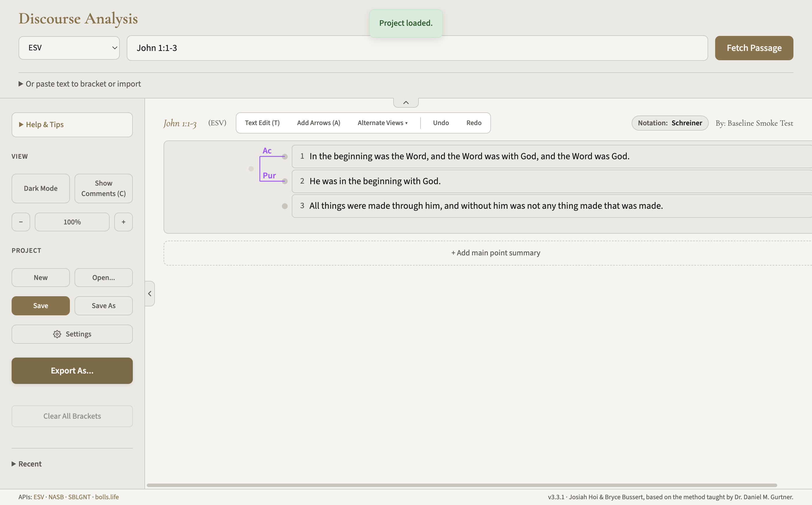

# 阶段 2.5：3.3.1 原版基线验证报告

验证日期：2026-11-03，北京时间。固定基线：`98da0241c38eef936be0f06cf736aa607dda0b62`，应用版本 3.3.1。

**结论：本轮要求的代码检查、全部既有单元测试、全部既有 E2E、完整构建，以及 Mac arm64 主要功能验证均已通过。** 保留一项原版编辑行为限制和签名限制，详见下文。没有实施国际化，没有修改上游业务代码，也没有升级 Electron 或依赖。

## 1. 原版 3.3.1 是否完整通过

在本轮明确的检查范围内，通过。不能把这个结果解释成已经穷尽所有使用场景，或已经验证正式签名、公证、所有网络服务及 Windows 运行。

验证前后分别确认：固定提交包含的 78 个受版本管理文件均与基线逐字节一致。Mac ZIP 解压后的应用内，36 个实际打包的源码／资源文件与工作区原版对应文件一致。锁文件未改动。

本轮使用 Node 26.12.0、npm 11.20.0、锁定的 Electron 28.3.3、electron-builder 24.13.3、Playwright 1.61.1，在 Apple Silicon arm64 Mac 上执行。

## 2. 哪些测试通过／失败

| 检查 | 最终结果 | 说明 |
| --- | --- | --- |
| `npm run check` | 通过，退出码 0 | 包含 ESLint、TypeScript 检查和全部单元测试 |
| 全部既有 unit tests | 275 / 275 通过 | 0 失败、0 跳过、0 取消；已由 check 完整执行，不把它重复算成两套测试 |
| `npm run test:e2e` | 30 / 30 通过，退出码 0 | 使用项目原配置；仅用环境变量把测试浏览器放在任务目录；没有删除、修改或弱化原测试 |
| `npm run build` | 通过，退出码 0 | 完整执行默认 Mac arm64 和 Windows x64 构建，没有只挑 Mac 成功部分代替整条命令 |
| 从实际 Mac ZIP 解压的桌面 smoke test | 14 / 14 通过 | 使用真实 Electron 应用及隔离数据目录，详见下表 |
| Mac ZIP 完整性及架构 | 通过 | ZIP CRC 校验通过，可执行文件为 Mach-O arm64 |
| 严格代码签名完整性校验 | 未通过 | 不是单元／E2E 失败；原构建没有有效 Developer ID 签名，未在本阶段修复 |

E2E 本来就阻断外部网络，所以另用真实桌面版进行在线经文载入验证。没有将模拟响应冒充真实接口成功。

桌面功能验证：

| 功能 | 实际检查 |
| --- | --- |
| 启动 | 从生成的 ZIP 解压并启动；应用报告 version=3.3.1、isPackaged=true、arch=arm64 |
| 首次欢迎 | 显示欢迎页，在隔离目录保存测试署名 |
| 经文载入 | 通过真实网络载入 John 1:1-3，返回 3 节文字及 `(ESV)` 标记，无响应替身 |
| 拆分／合并 | 在词边界按 Enter 拆成 4 行，再按 Backspace 合并回 3 行；文字与原载入内容一致 |
| 建立关系 | 通过圆点和选择器建立 Action-Purpose，确认图中出现相应括号 |
| profile 切换 | 五套全部切换；Gurtner／Beale 显示 Means-End，其他套显示 Action-Purpose；星号规则保留，底层 ID 不变 |
| 保存／打开 | 真实下载项目 JSON，并通过“打开本地文件”重新载入，核对 version=3、文字和关系 |
| PNG 导出及重新打开 | 生成带嵌入数据的 PNG，再通过打开文件恢复，文字和关系一致 |
| PDF 导出及重新打开 | 生成 PDF，检查文件头和嵌入数据，再通过打开文件恢复，文字和关系一致 |
| 窗口与错误 | 检查真实窗口截图，无页面运行错误；另外通过 macOS 窗口工具确认可见应用及菜单 |
| 重新启动 | 关闭后重启，Schreiner 偏好在隔离测试目录中保留 |

14 项是补充桌面检查步骤，不与 275 项单元或 30 项 E2E 相加冒充同一套测试。

## 3. Mac 桌面版能否正常构建和启动

能在本机构建和启动。已实际运行 ZIP 解压出的应用，完成上面的主要操作，并查看真实截图。

产物位于项目根目录 `dist/`：

- `Discourse Analysis-3.3.1-arm64-mac.zip`：91,730,757 字节。
- `mac-arm64/Discourse Analysis.app`：构建输出的应用目录。
- `Discourse Analysis 3.3.1 x64 Portable.exe`：69,638,053 字节。只验证构建产出，未在 Windows 上运行。

Mac ZIP SHA-256：

```text
ce308a0e44b49e9400c50439adb51e3bc7eb2d0e924ce4b93dcd20602f24d1c7
```

这是英文原版基线包，不是中文成品。没有复制到 Applications，也没有覆盖现有安装。

项目默认构建在找不到有效 Developer ID 身份时跳过签名，本轮保留了这一行为。额外运行 `codesign --verify --deep --strict` 未通过，输出为“code has no resources but signature indicates they must be present”。因此不能声称这是签名完整、可公证发布的成品；本机启动成功也不能代替网络下载后带隔离标记的 Gatekeeper 验证。没有重签名、关闭安全保护或删除隔离属性。

## 4. 出现的问题属于上游还是环境

### 安装环境：Electron 的解压未完整完成

按锁文件执行 `npm ci --ignore-scripts --no-audit --no-fund`，安装了 384 个原版本包，先不执行安装脚本。检查后只运行 Electron 的原下载／解压脚本；fsevents 当前发布包没有需要执行的安装脚本。

Electron 安装脚本两次以 0 退出，但解压目录不完整，缺少版本及路径文件，不能据此认为安装成功。下载的官方 28.3.3 arm64 ZIP 经包内 `checksums.json` 的 SHA-256 和全部 CRC 验证均正确，随后用 macOS 自带 `ditto` 完成同一 ZIP 的解压，并按原安装器预期写入路径文件；成功返回 v28.3.3。

这是安装／解压链在当前环境中的问题，不是应用业务代码失败。没有单独证实究竟是 Node 26 还是其解压依赖的具体缺陷，因此不把猜测当作结论。未升级或修改依赖源码。完整正式构建随后使用原命令自行下载、打包并成功。

### 启动测试：首次 12 秒判定超时

第一次自定义桌面启动检查使用 12 秒可见性等待，超时退出；扩大测试等待至 90 秒后，欢迎页、主窗口、在线载入和全部功能均可工作。只调整了任务自用检查脚本的等待时间，没有改应用启动逻辑。没有单独定位首次延迟的具体来源，不能武断归为确定的网络故障。

### 上游原版行为：词内拆分后合并会插入空格

首次自定义 smoke test 把 beginning 从词内拆开；原版合并会补一个可见空格，得到 be ginning。因此最初的“拆分再合并必须逐字节恢复”断言不成立，并连带导致后面的导入导出比较失败；这并不是五种相互独立的导入导出错误。

源码 `mergePropositions()` 明确采用单个可见空格连接，既有 E2E 也检查“merge joins with a visible space”。这是原版已存在的设计／限制。初次记录完整保留。随后在自然词边界完成可逆拆分／合并检查，JSON、PNG、PDF 的恢复文字也全部与原载入内容一致。

**使用建议：不要把英文词内拆分再合并当成无损还原；必要时使用撤销。** 本阶段没有修复或掩盖这一行为，也没有修改原测试。未来国际化回归应继承这个已记录的原版基线，避免把它误判为中文化新增问题。

### 签名：原构建缺少有效发布签名

严格签名校验失败属于原项目当前打包策略与本机无有效签名身份的组合状态；不是中文化引入的问题。是否在最终交付阶段改善签名属于另一个决定，本轮不改变策略。

## 5. 用户数据、范围与证据

14 项主要功能操作均使用项目 `scratch/phase25/native-profile-word-boundary` 独立数据目录，并在运行时核对 userData 和 sessionData 都指向该目录。隔离参数既核对了 [Electron 28.3.3 的参数处理源码](https://github.com/electron/electron/blob/v28.3.3/shell/app/electron_main_delegate.cc#L322)，也在本机读取实际路径确认。

最后补查 macOS 系统窗口时，窗口工具自动按默认偏好启动了一次应用；只查看窗口后退出，未编辑、导入、保存或发布用户项目。不能把这次只读窗口观察也说成使用了隔离偏好；没有对原用户数据做逐字节前后比较。

未写入云端协作或发布 profile；没有验证真实云端多用户协作。没有提供或读取新密钥。没有升级软件、改系统安全设置或更换原测试配置。

主要证据已保存在 [基线验证证据目录](基线3.3.1验证证据/)：check、E2E、构建和桌面日志、初次超时与词内拆分观察、最终 14 项结果、打包源码核对、产物哈希及实际截图。任务自用脚本、下载缓存、隔离用户目录和导出测试文件保留在 `scratch/phase25/`，不属于应用源码。



## 6. 是否建议正式进入阶段 3

**建议：基线已具备进入阶段 3 的条件。** 已有明确可重跑的测试和可运行 Mac 包；词内合并、安装解压和签名问题已与中文化工作区分并记录。已审定的术语以 v1.0 为准。

**本轮到阶段 2.5 结束，按你的要求暂停，不自动进入阶段 3。**
